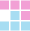
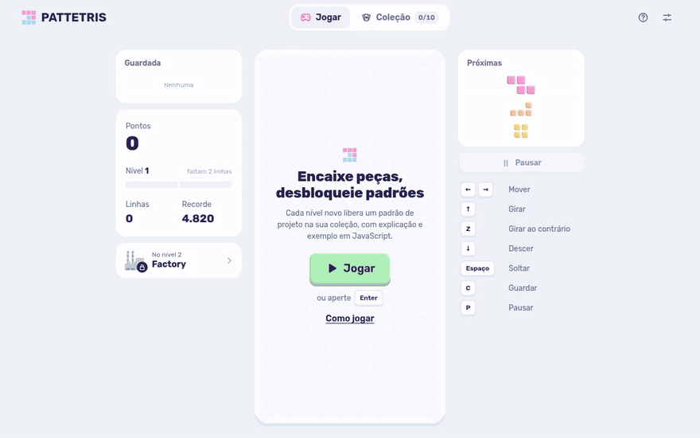
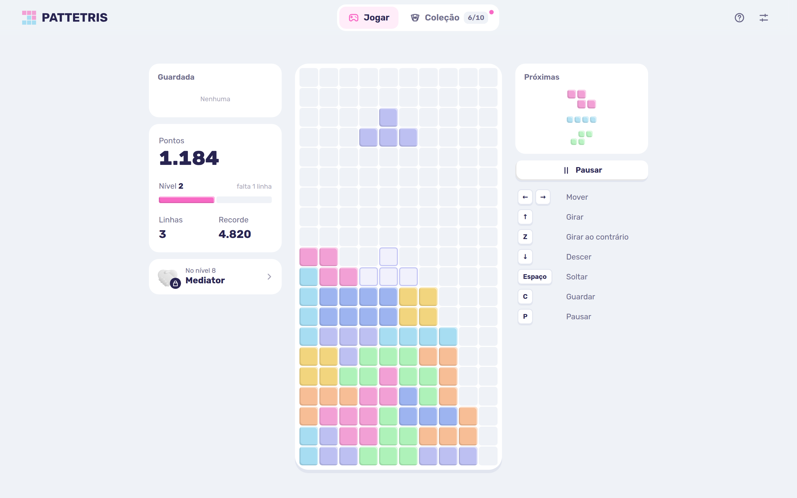
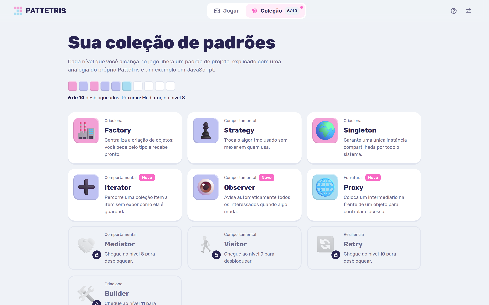
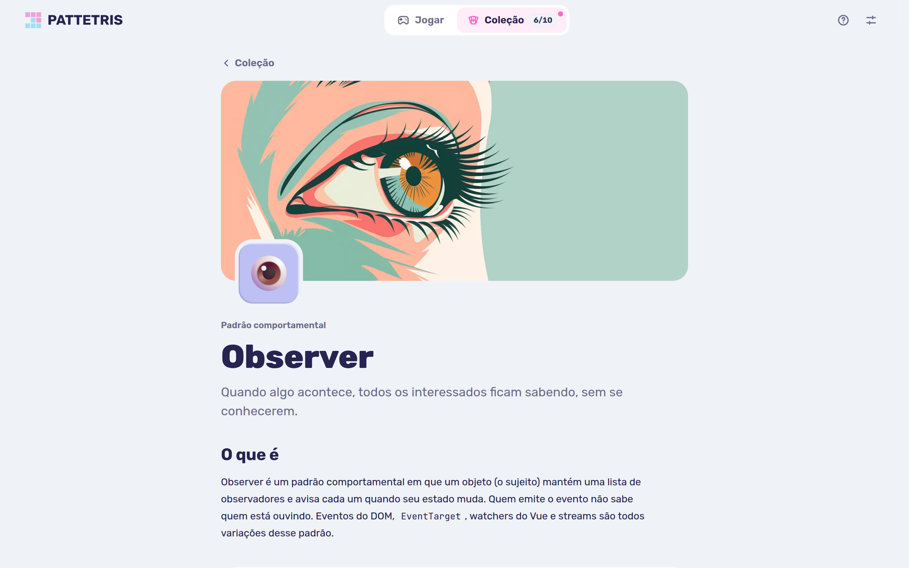

#  Pattetris

A falling-blocks game for learning design patterns. Every level you reach unlocks a pattern lesson, explained with an analogy from the game itself and a JavaScript example. The interface is in Portuguese.

**Live demo:** [pattetris](https://pattetris.vercel.app)



## Features

- **Unlock as you play**: each new level adds a design pattern to your collection, from level 2 up to level 11
- **10 patterns**: Factory, Strategy, Singleton, Iterator, Observer, Proxy, Mediator, Visitor, Retry and Builder, grouped by category
- **Lessons**: definition, a Pattetris analogy, a highlighted JavaScript example with a copy button, pros, pitfalls, real-world uses and further reading
- **Modern block game rules**: 7-bag randomizer, wall kicks, hold, three-piece preview, ghost piece and lock delay
- **Keyboard and touch**: arrow keys or WASD on desktop, on-screen buttons and swipe gestures on mobile
- **Saved progress**: best score, unlocked and read patterns are kept in `localStorage`
- **Settings**: light, dark or system theme, sound effects and ghost piece toggles

| Game | Collection | Lesson |
| --- | --- | --- |
|  |  |  |

## Tech stack

- [Vue 3](https://vuejs.org) with Vue Router and Pinia
- [Shiki](https://shiki.style) for code highlighting
- Sass
- Vite and Vitest

## Getting started

```bash
npm install
npm run dev
```

| Command           | Description                        |
| ----------------- | ---------------------------------- |
| `npm run dev`     | Start the dev server               |
| `npm run build`   | Build the static site into `dist/` |
| `npm run preview` | Preview the production build       |
| `npm test`        | Run the unit tests                 |

## Project structure

```
src/
├── components/   UI split by area: app, game, collection, lesson, ui
├── data/
│   ├── lessons/  Lesson text for each pattern
│   ├── code/     JavaScript examples shown in the lessons
│   └── ...       Pattern list and categories
├── game/         Game engine, pieces, controls and gestures
├── stores/       Pinia stores for progress and settings
├── views/        Game, collection and lesson pages
└── ...           Assets, composables, router and utils
```
